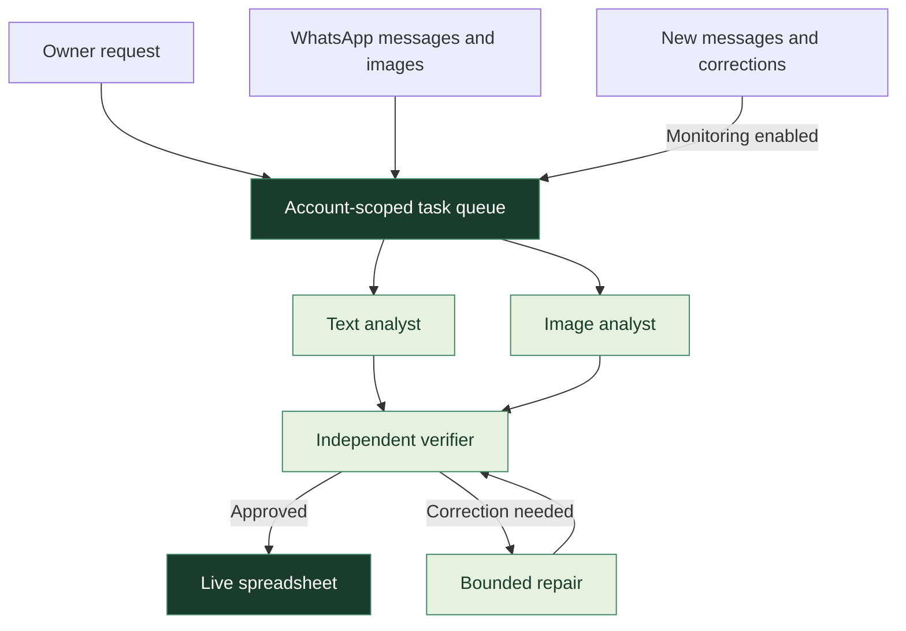

<div align="center">

<br>


# WABuddy

### Your WhatsApp. Your AI workspace.

Turn conversations into verified orders, reusable knowledge, and work that stays up to date.

**One prompt → Parallel agents → A checked result**

<br>


<br>

[Explore the app](https://wabuddy.my) · [Quick start](#quick-start) · [Features](#features) · [How it works](#how-it-works) · [MCP integration](#mcp-integration)

<br>

</div>

---

## Why WABuddy?

Customer orders rarely arrive as a tidy table. They arrive as messages, photos, follow-up questions, corrections, and cancellations.

WABuddy connects to your WhatsApp account and turns that conversation history into structured work. Ask for orders, inspect the agents as they work, and open a verified spreadsheet inside the app. When the conversation changes, monitoring updates the same sheet.

| Connect | Ask | Review |
| :--- | :--- | :--- |
| Link WhatsApp through the animated phone's pairing QR. | Describe the outcome you want in Chat. | Open the live spreadsheet, source evidence, and agent workflow. |

## Features

| | Capability | What you can do |
| :---: | :--- | :--- |
| 💬 | **Connected WhatsApp** | Switch saved accounts, browse synchronized chats, send messages and attachments, and see delivery/read receipts. |
| ✨ | **Prompt-driven tasks** | Start order analysis, question review, or monitoring with a natural-language request. |
| 🧩 | **Parallel agents** | Process text and image order sources in separate jobs, then independently verify the combined result. |
| 📊 | **Live spreadsheet** | Keep orders in the website, follow source evidence, filter records, and optionally export Excel. |
| 📚 | **Owner knowledge** | Hand unknown questions to the owner and reuse approved answers in future drafts. |
| 🕒 | **Monitoring & schedules** | Update results when messages change or run supported tasks on a schedule. |
| 🔎 | **Suspicious-message review** | Flag phishing-style messages for local review without automatically blocking or reporting accounts. |
| 🔌 | **MCP integration** | Let WorkBuddy or another MCP client submit goals, inspect execution, and retrieve verified results. |

> [!NOTE]
> Some business-profile editors remain interface previews. See [current scope](#current-scope) for the boundaries.

## Quick start

**Requirements:** Windows · PowerShell 7 · Python 3.12+ · Node.js 22.12+

```powershell
git clone https://github.com/lownamlee/WABuddy.git
cd WABuddy
./setup.ps1
./start-wabuddy.ps1
```

1. Open **http://127.0.0.1:8787**.
2. In WhatsApp, choose **Linked devices → Link a device** and scan the QR.
3. Configure your execution engine in **Settings**.
4. Open **Chat**, ask “Organize my customer orders into a spreadsheet and keep it updated.”, and view the result in **Spreadsheet**.

Each installation starts without linked accounts or AI credentials. Pairing codes come from the actual WhatsApp connector.

<details>
<summary><strong>Starting, stopping, and saved sessions</strong></summary>

The launcher starts a local watchdog that recovers an exited server. You can also launch through **Open WABuddy.cmd**.

```powershell
./stop-wabuddy.ps1
```

Stopping pauses automatic recovery and preserves linked-device sessions. Explicit logout unlinks the selected account. Hosting and local AI execution require the computer to remain awake and connected.

</details>

## Ask Buddy

| Request | Outcome |
| :--- | :--- |
| “Organize my customer orders into a spreadsheet and keep it updated.” | Build the orders spreadsheet and watch for changes. |
| “Organize orders from [customer name or international phone number] into a spreadsheet and keep it updated.” | Limit the order workflow to one synchronized conversation. |
| “Ask me when you don’t know an answer, and remember my approved answers for that customer.” | Review questions, hand off unknown answers, and use owner-approved knowledge. |
| “Check my messages for possible phishing and flag them for my review.” | Review suspicious messages in the local queue. |
| “Stop monitoring my conversations.” | Pause the selected account's monitoring policies. |

Write naturally—there is no required command vocabulary. The AI coordinator interprets your request, selects the relevant conversations, and plans the supported workflow. Name a customer or provide their international phone number when you want a specific conversation. One-word shortcuts remain optional; they are not the main interaction.

**Choose your execution engine in Settings:**

- **Local Codex:** use an installed Codex CLI and your own sign-in on the hosting computer.
- **Compatible APIs:** configure your own text and vision providers. Image analysis needs a vision-capable model.
- **MCP worker:** leave automatic execution off when an active external agent will process the queue.

Provider availability and quotas apply separately from WABuddy's application limits. Remembering an answer or generating a draft does not automatically send a WhatsApp message.

## How it works



Parallel reading is used when both text and image sources are present. Each specialist owns its assigned records while receiving surrounding context for corrections. A verifier checks their merged output before publication. Failed work leaves the previous verified sheet available.

The Agent team view reflects actual jobs, dependencies, and status. The spreadsheet keeps cancelled orders visible, excludes them from confirmed totals, and distinguishes customer payment claims from independently verified payment.

## Technology

| Layer | Built with |
| :--- | :--- |
| **Interface** | TypeScript, React, Vite, Tailwind CSS, shadcn/ui |
| **Animation & visualization** | Three.js, React Flow, Recharts |
| **Backend** | Python, FastAPI, Uvicorn, Pydantic |
| **WhatsApp connection** | Neonize, linked-device sessions |
| **AI execution** | Local Codex or compatible text/vision APIs |
| **Agent integration** | MCP with account-bound tools and leased jobs |
| **Storage & exports** | Private local SQLite storage, openpyxl |

## MCP integration

WABuddy exposes the same live backend to WorkBuddy and other MCP clients. With the application running, launch the account-bound server:

```powershell
./.venv/Scripts/python.exe -m wabuddy.live_mcp --account default
```

Set the MCP client's working directory to this repository. Each server stays bound to its selected saved account.

| Tool | Purpose |
| :--- | :--- |
| `get_capabilities` | Discover supported operations. |
| `read_whatsapp` | Verify the connected profile and read supported account information. |
| `get_execution_engine` | Check whether automatic workers are enabled. |
| `submit_goal` | Start an owner-requested workflow. |
| `get_run` | Inspect job status, dependencies, and results. |
| `get_spreadsheet` | Read verified rows, totals, and revision metadata. |

Read the account identity before acting, preserve request IDs when retrying mutations, and do not claim jobs already handled by automatic workers. Registering an MCP connection alone does not execute queued reasoning tasks.

## Development

<details>
<summary><strong>Project structure</strong></summary>

```text
WABuddy/
├── backend/wabuddy/       Python API, connector, agents, and MCP
├── frontend/
│   ├── src/               React interface, phone animation, and assets
│   └── tests/             Frontend behavior tests
├── tests/                 Backend and integration tests
├── phone-animation.html   Application entry point
├── setup.ps1              Install dependencies and build
├── start-wabuddy.ps1       Start the app and watchdog
└── stop-wabuddy.ps1        Stop the app and automatic recovery
```

</details>

Run the backend and frontend in separate terminals:

```powershell
# Backend
./.venv/Scripts/python.exe -m wabuddy

# Frontend, in a second terminal
npm run dev
```

Validate changes:

```powershell
npm run build
npm test
./.venv/Scripts/python.exe -m pytest -q
```

The production build is generated in `frontend/dist` and served by Python. Test fixtures do not require personal account data.

## Current scope

| Available | Boundary |
| :--- | :--- |
| Synchronized chats and image analysis | Full phone-history coverage is not guaranteed; audio transcription is not implemented. |
| Standard and Business interface modes | Native catalog, registered business name, and operating-hours editing are not supported by the current connector. |
| Owner-approved knowledge and drafts | These workflows do not automatically send replies. |
| Local suspicious-message review | No automatic account blocking or reporting. |
| Hosted website and local AI engine | The hosting desktop, connector, and network must remain available. |

## Data & deployment

Device sessions, account data, model configuration, and logs belong in private `.local` storage. They are excluded from this repository and must not be served as static files. Pairing payloads, API keys, OAuth credentials, exported chats, and account screenshots must remain private.

The service binds to loopback by default. Existing public-origin checks reference `wabuddy.my`; another deployment must explicitly configure its own allowed origin and reverse proxy. No tunnel credentials or machine-specific deployment configuration are included.

---

<div align="center">

**Built around conversations. Designed for completed work.**

[WABuddy](https://wabuddy.my) · [Source code](https://github.com/lownamlee/WABuddy) · [Third-party credits](THIRD_PARTY_NOTICES.md)

<sub>Uses the unofficial Neonize connector. Not affiliated with WhatsApp or Meta.<br>Bundled assets and components retain their respective licenses.</sub>

</div>
